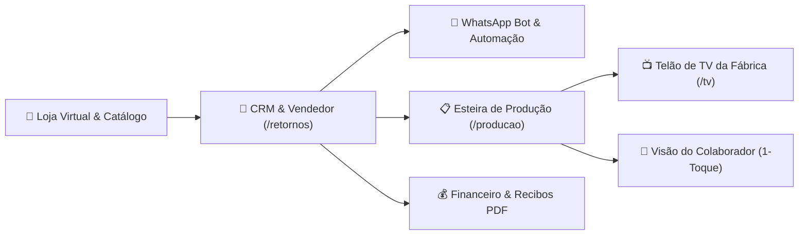
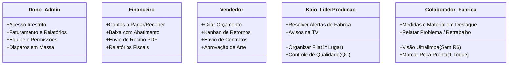

# TOLDOS PRINT — RELATÓRIO EXECUTIVO & MANUAL DE OPERAÇÃO

> **Documento Oficial de Alinhamento e Treinamento da Equipe**  
> **Data:** 20 de Novembro de 2026  
> **Versão:** 2.0 (Produção Homologada)  
> **PDF Oficial Gerado:** [Baixar PDF Executivo (11 Páginas)](file:///home/luiz-felippe/Área%20de%20trabalho/Area%20de%20trabalho%20/empresa/grafica/RELATORIO_ALINHAMENTO_SISTEMA.pdf) ou via navegador em [relatorio-alinhamento-sistema.pdf](file:///home/luiz-felippe/Área%20de%20trabalho/Area%20de%20trabalho%20/empresa/grafica/public/relatorio-alinhamento-sistema.pdf)

---

## 1. Visão Geral da Evolução (11 a 20 de Novembro de 2026)

Nos últimos 10 dias de desenvolvimento contínuo foram entregues **133 commits** e dezenas de novos módulos e melhorias estruturais. O sistema da Toldos Print deixou de ser apenas um controle interno de orçamentos e tornou-se um **ecossistema operacional unificado**, interligando:

### Números do Desenvolvimento
- **133 commits** entregues em produção no branch `main`.
- **275 testes automatizados unitários e de integração** passando com 100% de taxa de sucesso (`vitest run`).
- **100% de responsividade mobile**, permitindo que vendedores na rua, operadores no chão de fábrica e diretores pelo celular usem o sistema sem cortes de tela.
- **Compilação otimizada** em Next.js Turbopack com geração estática e rotas dinâmicas de alta performance.

---

## 2. Linha do Tempo das Implementações (Dia a Dia)

| Período | Módulos e Entregas Principais |
| :--- | :--- |
| **11 a 12/Nov** | **Aprovação de Arte e Contratos:** Anexo de artes no card da produção, link público para o cliente aprovar arte pelo celular (`/arte/[id]`), envio automático de contratos assinados por WhatsApp, cálculo de acréscimo/desconto e parcelamento (entrada + restante). Retorno automático de clientes com detecção de intenção pelo WhatsApp. |
| **14/Nov** | **Telão TV & Responsividade Completa:** Central de Controle da TV (`/avisos-tv`) com letreiro urgente, auto-scroll contínuo para Smart TVs sem travamentos, instruções da fábrica nos cards, redesenho mobile de todas as telas (materiais, acabamentos, financeiro, relatórios com exportação Excel e impressão A4) e lixeira de exclusões com restauração em 1 clique. |
| **15 a 18/Nov** | **Infraestrutura Offline & Resiliência:** Sincronização offline com fila local no IndexedDB, prevenção de duplicidade de clientes por telefone e validação de documentos fiscais. |
| **19/Nov** | **WhatsApp Bot Inteligente & Recibos em PDF:** Gerador de código numérico de 8 dígitos para pareamento remoto do WhatsApp sem precisar de câmera, funil de conversão de leads, proteção contra contatos irrelevantes na base, gerador de PDF oficial de recibos e orçamentos no servidor (`jsPDF`) e botão de envio direto do comprovante no WhatsApp do cliente. |
| **20/Nov (Hoje)** | **Loja Virtual & Nova Produção do Colaborador:** APIs da Loja Online (`/api/loja/catalogo`, `/api/loja/pedidos`), segregação total de papéis para o chão de fábrica (colaborador não vê contratos nem valores financeiros), botão de 1 toque "Marcar Peça como Pronta", sistema de alerta de problemas com aviso sonoro e tarja vermelha na TV, Sininho e Dashboard, além da Central de Notificações categorizada e modal unificado "Mais Detalhes". |

---

## 3. Matriz de Perfis de Acesso & Segurança

Para garantir que dados financeiros permaneçam confidenciais e que o chão de fábrica tenha foco total na execução física:

---

## 4. Detalhamento dos Módulos Principais

### 4.1. Loja Virtual & Catálogo Online
- **APIs Conectadas:** O site institucional da Toldos Print consome diretamente a lista atualizada de produtos, materiais e serviços (`/api/loja/catalogo`).
- **Cálculo em Tempo Real:** O cliente insere as medidas no site e o sistema calcula a metragem quadrada e apresenta a estimativa de investimento.
- **Pedido Integrado:** Ao enviar o pedido pelo site, o sistema verifica se o telefone já existe na base. Se sim, vincula ao histórico; se não, cria o cliente com a tag `Origem: Loja Virtual` e envia o pedido para a esteira de `Aguardando Retorno`.

### 4.2. Esteira de Produção (/producao)
- **8 Etapas Definidas:** Aprovado/Produção → Arte Enviada → Ag. Confirmação → Impressão/Solda → Acabamento → Controle de Qualidade (QC) → Pronto p/ Retirada/Instalação → Entregue.
- **Modo Colaborador:** Interface minimalista, botões grandes e fontes nítidas. O colaborador só vê o que interessa para fazer a peça física.
- **Sistema de Alerta de Problemas:**
  - Botão vermelho **"Relatar Problema na Peça"** no card do colaborador.
  - Alerta emite tarja vermelha viva pulsante no card, acende o sininho do Kaio e do Dono e destaca a peça na TV da oficina.
  - Botão **"Resolver ✓"** limpa o alerta após a solução técnica ser dada pelo Kaio.
- **Modal "Mais Detalhes":** Remove poluição visual do card e reúne Data de Emissão, Tipo de Orçamento, Status de Assinatura e links diretos para abrir o PDF da Ordem de Serviço e o Contrato Digital.

### 4.3. Telão da Fábrica (Painel TV - /tv)
- **Auto-Scroll Inteligente:** Rola suavemente verticalmente sem travar a Smart TV, permitindo acompanhar todos os pedidos da fila de trabalho.
- **Letreiro Urgente:** Mensagens digitadas na Central do Telão (`/avisos-tv`) passam no topo da tela em destaque amarelo/vermelho.
- **Disparo no WhatsApp da Equipe:** Com um clique, os mesmos avisos são enviados para os telefones de todos os funcionários da fábrica.

### 4.4. Automação WhatsApp & Atendimento (Evolution API)
- **Pareamento por Código de 8 Dígitos:** Não exige escanear QR Code presencialmente; permite conexão remota instantânea.
- **Reconhecimento Automático:** Identifica clientes conhecidos e nunca pergunta nome ou cidade repetidamente.
- **Envio de Documentos Oficiais:** Disparo de PDFs reais de Orçamentos, Ordens de Serviço, Contratos e Recibos com comprovante de pagamento.

### 4.5. Módulo Financeiro (/financeiro)
- **Baixa Flexível:** Registra pagamentos parciais (entradas de 50%, parcelas) e recalcula automaticamente o saldo restante devido.
- **Recibo em PDF Oficial:** Geração automática do recibo comercial timbrado com dados do pagador, valor por extenso e botão direto para enviar no WhatsApp do cliente.

---

## 5. Roteiro Prático para a Reunião de Alinhamento com a Equipe

Use esta seção para guiar a reunião com a equipe:

### 💼 Para os Vendedores:
1. **Cadastre com precisão:** Medidas e materiais digitados no orçamento são lidos pela fábrica e aparecem no telão.
2. **Use o botão de Contrato:** Envie o link de assinatura pelo WhatsApp antes de mandar para a produção.
3. **Monitore os Retornos diariamente:** Orçamentos atrasados aparecem em destaque no CRM (`/retornos`).

### 🎨 Para o Designer:
1. **Anexe a arte no sistema:** Suba o arquivo da prova visual no card correspondente na tela de `/producao`.
2. **Envie o link de aprovação:** O cliente aprova com 1 toque no celular dele.
3. **Aprovação automática:** Quando o cliente aprova, a peça entra automaticamente para impressão.

### 👷 Para os Colaboradores da Fábrica:
1. **Olhe o Telão ou o Celular:** A peça em 1º lugar na fila é a que tem a medalha de ouro 🥇 e prioridade máxima de montagem.
2. **Conferir medidas em amarelo:** Sempre verifique a largura e altura antes de cortar a lona ou o tubo de ferro.
3. **Deu problema? Aperte o botão vermelho "Relatar Problema":** Avise imediatamente para o Kaio saber que a peça está travada.
4. **Terminou? Aperte o botão verde "Marcar como Peça Pronta":** Isso notifica o Kaio para inspecionar e registrar a foto de conferência.

### 🛠️ Para o Kaio (Líder da Produção):
1. **Organize a ordem:** Use o botão **"🔝 1º"** para colocar pedidos urgentes no topo da fila.
2. **Resolva alertas:** Ao orientar o operador e sanar a falha, clique em **"Resolver ✓"**.
3. **Controle de Qualidade (QC):** Confira acabamento, medidas e anexe a foto da peça finalizada antes de liberar para instalação.
4. **Comunique no Telão:** Use a Central de Avisos para avisar a fábrica sobre prazos ou recados gerais.

---

## 6. Arquivos Gerados & Links Rápidos

- 📄 **PDF Oficial Completo (11 páginas):** [Abrir RELATORIO_ALINHAMENTO_SISTEMA.pdf](file:///home/luiz-felippe/Área%20de%20trabalho/Area%20de%20trabalho%20/empresa/grafica/RELATORIO_ALINHAMENTO_SISTEMA.pdf)
- 🌐 **PDF na pasta pública (Web):** [public/relatorio-alinhamento-sistema.pdf](file:///home/luiz-felippe/Área%20de%20trabalho/Area%20de%20trabalho%20/empresa/grafica/public/relatorio-alinhamento-sistema.pdf)
- 💻 **Código-Fonte da Produção:** [app/(app)/producao/page.tsx](file:///home/luiz-felippe/Área%20de%20trabalho/Area%20de%20trabalho%20/empresa/grafica/app/(app)/producao/page.tsx)
- 📺 **Código-Fonte do Telão:** [app/tv/page.tsx](file:///home/luiz-felippe/Área%20de%20trabalho/Area%20de%20trabalho%20/empresa/grafica/app/tv/page.tsx)
- 💰 **Código-Fonte do Financeiro:** [app/(app)/financeiro/page.tsx](file:///home/luiz-felippe/Área%20de%20trabalho/Area%20de%20trabalho%20/empresa/grafica/app/(app)/financeiro/page.tsx)
- 🛍️ **Rotas da Loja Virtual:** [app/api/loja/pedidos/route.ts](file:///home/luiz-felippe/Área%20de%20trabalho/Area%20de%20trabalho%20/empresa/grafica/app/api/loja/pedidos/route.ts)
